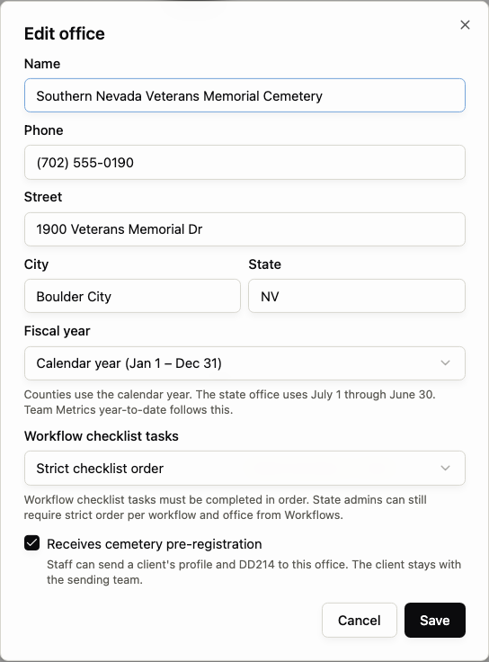
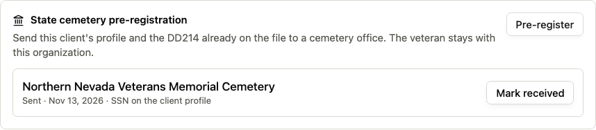
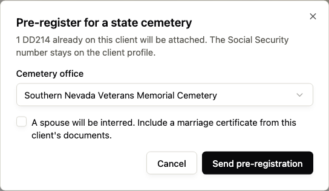

## Overview

On an organization that uses offices, an owner marks a cemetery office. Staff then send that client's profile and the DD214 already on the file. The client stays with the sending organization. This does not reserve a plot, transfer the client, or file a federal burial form.

*Settings, then Offices, then Edit. Check Receives cemetery pre-registration, then Save.*

## Before you begin

Offices is already enabled for the organization, and the cemetery is an active office. A DD214 is already on the client's Documents tab. The client is not recorded as deceased. When the veteran has died, call the cemetery to schedule burial.

## Turn on the cemetery office

<Steps>
  <Step title="Open Offices">An owner or admin opens Settings, then Offices.</Step>
  <Step title="Edit the cemetery">Choose Edit on the cemetery office.</Step>
  <Step title="Turn on pre-registration">Check Receives cemetery pre-registration and choose Save. The office list shows Cemetery beside that office.</Step>
</Steps>

Only active offices with this checked appear when staff send a packet. Creating an office does not turn this on by itself.

## Send the packet

Open the client and stay on Details. The State cemetery pre-registration card sits above the profile form.

*The card lists each send and offers Pre-register.*

<Steps>
  <Step title="Open Pre-register">Choose Pre-register. It stays unavailable until a DD214 is on the file and a cemetery office is turned on.</Step>
  <Step title="Choose the cemetery">Select the cemetery office. The dialog states how many DD214s will be attached. The Social Security number stays on the client profile and is not copied into the packet.</Step>
  <Step title="Spouse interment">If a spouse will be interred, check that option and pick the marriage certificate from documents already on the client. Press Enter in the search box to filter the list.</Step>
  <Step title="Send">Choose Send pre-registration. The card shows Sent. The client remains with your organization.</Step>
</Steps>

*Choose the cemetery, then Send pre-registration.*

Members whose home office is that cemetery are notified and can open the client from Notifications. If nobody has that home office, the notice goes to the organization.

## Mark the packet received

Someone at the destination cemetery, or an owner or admin, opens the same client and chooses Mark received. Staff at another office can see Sent and cannot mark it received.

Received stays on the card. Sending again creates another handoff. It does not replace the earlier one.

## Related workflows

<CardGroup cols={2}>
  <Card title="Client details" icon="user-pen" href="/veteran-records/client-details">Review the client profile used in the packet.</Card>
  <Card title="Documents" icon="files" href="/core-workflows/documents">Add the DD214 before sending.</Card>
</CardGroup>
